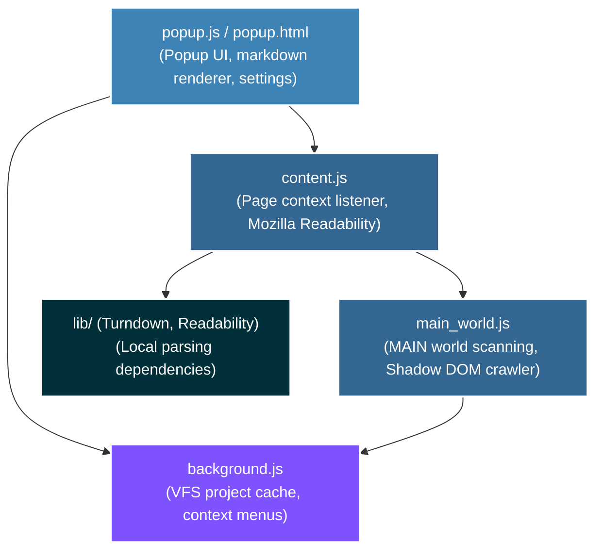

# Web2MD — Page to Markdown (web2md-extension)

> Premium, lightweight Chrome Extension (Manifest V3) that extracts clean content and React VFS workspaces from any web page and converts them into AI-ready Markdown locally in your browser.

   

---

<p align="center">
  <a href="#-quick-start"></a>
  <a href="#-architecture"></a>
  <a href="#-features"></a>
</p>

---

## 🗺️ Documentation Directory

|  #  | File / Resource              | Description                                                                              |
| :-: | :--------------------------- | :--------------------------------------------------------------------------------------- |
|  1  | **[manifest.json](manifest.json)** | Extension metadata, permissions (activeTab, storage, scripting), and content script registration |
|  2  | **[main_world.js](main_world.js)** | MAIN world script traversing Shadow DOM recursively and scoring VFS workspace candidates |
|  3  | **[content.js](content.js)**   | Content script running Mozilla Readability on page DOM and routing messages to background |
|  4  | **[background.js](background.js)** | Background service worker caching React VFS projects by Tab ID and registering context menus |
|  5  | **[popup.js](popup.js)**       | Popup interface driver converting HTML payload to GFM Markdown with live settings toggle  |

---

## 🏛️ Architecture

The extension implements a decoupled message-passing pattern to scan, cache, and serialize project directories from nested React applets:



---

## ⚡ Features

*   ⚡ **Local Content Extraction**: Powered by Mozilla's `Readability.js` to automatically filter out ads, navigation headers, footers, and sidebars.
*   📦 **React VFS Workspace Scraper**:
    *   Traverses **Shadow DOM** recursively to bypass Web Component boundaries.
    *   Inspects global `window` variables and React Fiber `__reactFiber$` trees.
    *   **Scoring Candidates Algorithm**: Evaluates multiple structures and automatically filters out package imports maps (e.g. `esm.sh`) in favor of genuine codebases.
*   📝 **Markdown Conversion**: Uses `Turndown.js` with GitHub Flavored Markdown (GFM) support for table formatting, strikethrough, list items, and fenced code blocks.
*   🎨 **Premium UI/UX**: Dark mode styling using modern typography (`Outfit` and `JetBrains Mono`), sleek linear gradients, smooth hover states, and reactive rendering.
*   🖱️ **Right-click Context Menu**: Convert whole pages or highlighted selections directly from the cursor to the clipboard with real-time toast notification feedback in the active page.
*   📊 **Token Counter**: Real-time character count and rough token count estimation (chars/4) to control prompt size for LLM contexts.

---

## 🚀 Quick Start

Ensure you have **Google Chrome** (or any Chromium browser) installed.

### 1. Load Unpacked Extension
1. Navigate to `chrome://extensions/` in the browser address bar.
2. Enable **Developer mode** via the toggle switch in the top-right corner.
3. Click the **Load unpacked** button in the top-left corner.
4. Select this directory: `/Users/hiepleh.n/p-source/web2md-extension`.

### 2. Run Diagnostic Scan (Optional)
Open the Chrome DevTools console on target pages (e.g., Google AI Studio) and type:
```javascript
window.web2mdScan();
```
This prints the identified candidate scoring details.

---

## 🧪 Development Configurations

Local git user details are pre-configured:
```bash
git config user.name "HiepLeHoaiNghia"
git config user.email "hiep.lhn@gmail.com"
```

---

## 🌐 Hướng dẫn mở Gói ZIP / HTML đã clone đúng cách (How to run cloned HTML & ZIP Package)

Khi tải xuống dưới định dạng **ZIP Package**, cấu trúc thư mục của trang web sau khi giải nén sẽ bao gồm:
- `index.html`: Cấu trúc DOM chính của trang web (đã được liên kết với CSS và JS ngoài).
- `styles.css`: Chứa toàn bộ CSS của trang web đã được trích xuất.
- `scripts.js`: Chứa mã JavaScript tương tác (nếu bạn bật tùy chọn *Preserve JS*).
- `assets/`: Thư mục chứa hình ảnh, font chữ, icon đã được tải về dưới dạng tệp tin cục bộ.

Do các chính sách bảo mật nghiêm ngặt của trình duyệt (CORS / Same-Origin Policy) đối với giao thức `file://`:
- Một số script động, web fonts hoặc tài nguyên trong Shadow DOM có thể bị chặn load nếu bạn chỉ click đúp mở trực tiếp file `index.html`.
- Các tính năng giả lập API Mocking cũng yêu cầu origin an toàn (`http://localhost`) để hoạt động đầy đủ.

### Hướng dẫn chạy gói mã nguồn:

#### Bước 1: Giải nén tệp ZIP
Giải nén tệp tin ZIP bạn vừa tải về để có thư mục chứa mã nguồn hoàn chỉnh.

#### Bước 2: Chạy qua Local HTTP Server (Khuyên dùng)
Hãy khởi chạy một server HTTP local ngay trong thư mục giải nén để trình duyệt cấp origin `http://localhost`. Bạn có thể chọn một trong các cách sau:

##### Cách 1: Sử dụng Node.js
Nếu máy bạn đã cài Node.js, hãy mở Terminal tại thư mục vừa giải nén và chạy:
```bash
npx http-server -p 8080
# Hoặc
npx serve
```
Sau đó truy cập đường dẫn hiển thị (ví dụ: `http://localhost:8080`).

##### Cách 2: Sử dụng Python (Sẵn có trên macOS/Linux)
Mở Terminal tại thư mục vừa giải nén và chạy:
```bash
python3 -m http.server 8000
```
Sau đó truy cập `http://localhost:8000` trong trình duyệt.

##### Cách 3: Sử dụng Extension VS Code (Giao diện đồ họa)
1. Mở thư mục đã giải nén bằng VS Code.
2. Đảm bảo đã cài đặt extension **Live Server**.
3. Click chuột phải vào file `index.html` và chọn **"Open with Live Server"**.
