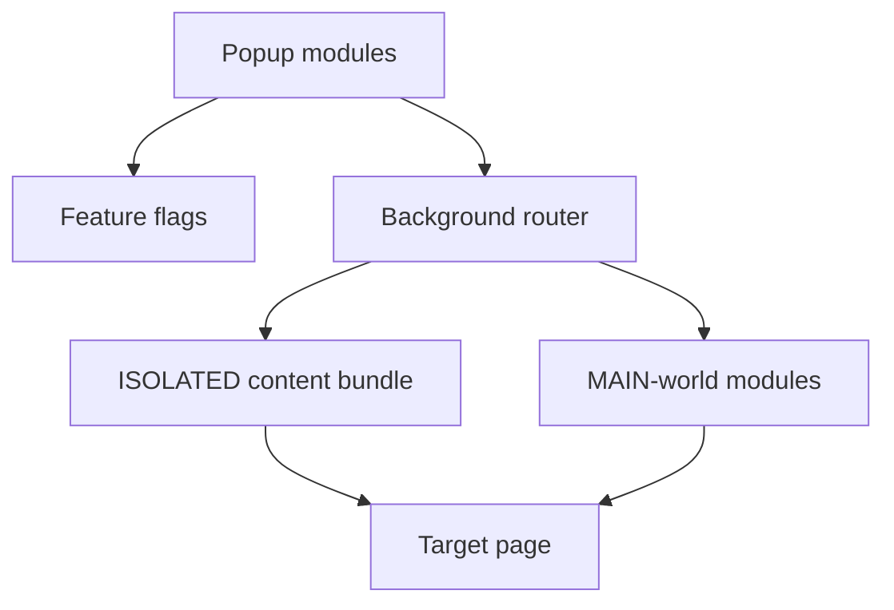

<!-- markdownlint-disable MD013 MD033 MD045 -->

# Web2MD — Chrome Extension

> Manifest V3 Chrome extension that converts web pages, selected regions, cloned HTML packages, API traffic, and React/VFS workspaces into AI-ready artifacts from a no-build JavaScript codebase.


## Contents

- [Quick start](#quick-start)
- [Feature matrix](#feature-matrix)
- [Architecture](#architecture)
- [Diagnostics](#diagnostics)
- [Testing](#testing)
- [Privacy](#privacy)
- [Local server for cloned packages](#local-server-for-cloned-packages)

## Quick start

1. Open `chrome://extensions/` in Chrome or another Chromium browser.
2. Enable **Developer mode**.
3. Select **Load unpacked**.
4. Choose the repository folder that contains this README and `manifest.json`.

No install, package, transpile, or build command is required. The extension runs directly from the source files declared in `manifest.json` and `src/shared/constants.js`.

## Feature matrix

| Canonical doc                                                                       | Flag            | Default | Injection timing                                                                                                                   | Reload nuance                                                                                                                                                                              |
| ----------------------------------------------------------------------------------- | --------------- | :-----: | ---------------------------------------------------------------------------------------------------------------------------------- | ------------------------------------------------------------------------------------------------------------------------------------------------------------------------------------------ |
| [Markdown/HTML extraction](docs/features/markdown-html-extraction/feature.md)       | `markdown`      |   ON    | Lazy content-bundle injection when extraction or conversion is requested.                                                          | No blanket reload; retry injection is attempted when the content script is not ready.                                                                                                      |
| [Region selection](docs/features/region-selection/feature.md)                       | `regionSelect`  |   ON    | Lazy content-bundle injection from the popup toggle. Context-menu capture requires the content listener to have been loaded first. | No blanket reload. Context menu copies the last right-clicked DOM element region, not highlighted text selection or the whole page.                                                        |
| [HTML clone, ZIP, and Netlify](docs/features/html-clone-zip-netlify/feature.md)     | `htmlClone`     |   ON    | Lazy content-bundle injection during extraction/clone; JSZip is part of the content bundle.                                        | No blanket reload. Use a local HTTP server for realistic package playback.                                                                                                                 |
| [API mocking](docs/features/api-mocking/feature.md)                                 | `apiMock`       |   OFF   | Persistent `document_start` registration for MAIN-world core/API scripts plus bridge files on all matching pages.                  | Reload after enable and after disable. Complete fetch/XHR history and mocking require the interceptor to exist before page scripts run.                                                    |
| [Component inspector](docs/features/component-inspector/feature.md)                 | `inspect`       |   OFF   | On-demand popup toggle injection of content bridge plus MAIN-world core/API/VFS/inspector parts.                                   | No blanket reload. API history before toggling is only available if `apiMock` was already active early.                                                                                    |
| [Visual edit](docs/features/visual-edit/feature.md)                                 | `visualEdit`    |   OFF   | Lazy content-bundle injection from popup toggle.                                                                                   | No blanket reload. Visual edit, inspect, and region selection are mutually exclusive.                                                                                                      |
| [React VFS project detection](docs/features/react-vfs-project-detection/feature.md) | `projectDetect` |   OFF   | VFS MAIN-world scanner injection is requested on the extraction retry path when the content bundle is not already present.         | If the base content bundle already responds, extraction currently falls back after 500 ms without injecting VFS. Reload or use Inspect to inject VFS before running `window.web2mdScan()`. |

## Architecture

Web2MD is a portable, no-build MV3 extension. `manifest.json` points at the ES-module service worker in `src/background/index.js`; there are no static `content_scripts`. The background service worker owns message routing, context-menu setup, feature-flag synchronization, dynamic script injection, asset proxying, downloads, API-call storage, and project-file storage.



### Injection policy

Core behavior is lazy by default: a tab receives Web2MD scripts only after a user action needs them. The exception is `apiMock`, which registers MAIN-world API interception at `document_start` because fetch/XHR must be patched before site scripts issue early requests. Changing `apiMock` affects registered content scripts, so reload the target tab after enabling or disabling it.

`inspect` can inject the API interceptor on demand, but that only captures traffic after injection. Use `apiMock` plus reload when early API history or complete mock coverage matters.

## Diagnostics

### VFS scanner

`window.web2mdScan` is installed by `src/main-world/vfs-scanner.js`, not by the base page. Seeing `undefined` before injection is expected.

To run the manual VFS diagnostic reliably with the current implementation:

1. Enable **Inspect** and toggle it on once; that on-demand path injects the VFS scanner together with the inspector parts.
2. Alternatively, enable `projectDetect` before the first extraction on a fresh/reloaded tab so the extraction retry path can request VFS injection.
3. If the base content bundle was already loaded, Project Detection alone currently reaches the 500 ms fallback without injecting VFS; reload the tab or use the Inspect path above.
4. Open page DevTools and run:

```javascript
window.web2mdScan();
```

The scanner checks window globals, Shadow DOM, and React Fiber trees, scores candidates, and filters obvious import-map style false positives.

## Testing

Run the repository static checks directly with Node:

```bash
node tests/static-checks.mjs
```

Current committed static-check state: **10/10 checks pass**. Live browser smoke testing is still **manual-pending**.

There is no package install, build, bundle, or generated output step for normal development.

## Privacy

| Area                               | Behavior                                                                                                                                            |
| ---------------------------------- | --------------------------------------------------------------------------------------------------------------------------------------------------- |
| Extraction and Markdown conversion | Runs locally in the browser tab and extension context.                                                                                              |
| HTML clone and ZIP                 | May ask the background service worker to fetch cross-origin stylesheets, scripts, images, fonts, or other assets so packages can be self-contained. |
| Netlify deploy                     | Optional. Uses the Netlify API only when the user provides a Personal Access Token and clicks deploy.                                               |
| Netlify PAT storage                | Stored through local-only extension storage. Legacy synced token copies are migrated out and removed.                                               |
| API mocking                        | Intercepts fetch/XHR in the page MAIN world only when the relevant feature path is injected or registered.                                          |

## Local server for cloned packages

For cloned HTML or ZIP packages, prefer an HTTP origin over opening `index.html` through `file://`. This avoids common browser restrictions around CORS, module/script loading, fonts, and mocked API playback.

```bash
python3 -m http.server 8000
# then open http://localhost:8000
```

Node-based static servers such as `npx http-server -p 8080` or `npx serve` also work when available. See the [HTML clone, ZIP, and Netlify feature doc](docs/features/html-clone-zip-netlify/feature.md) for feature-specific package guidance.
