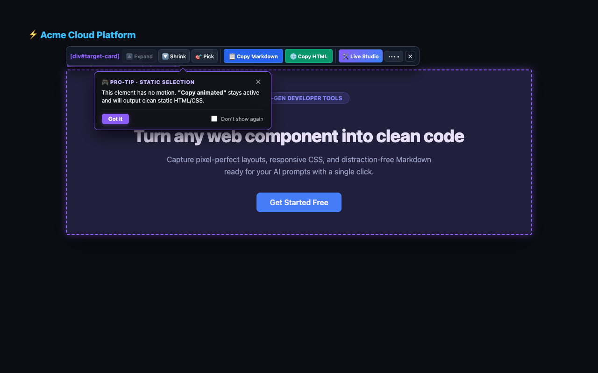
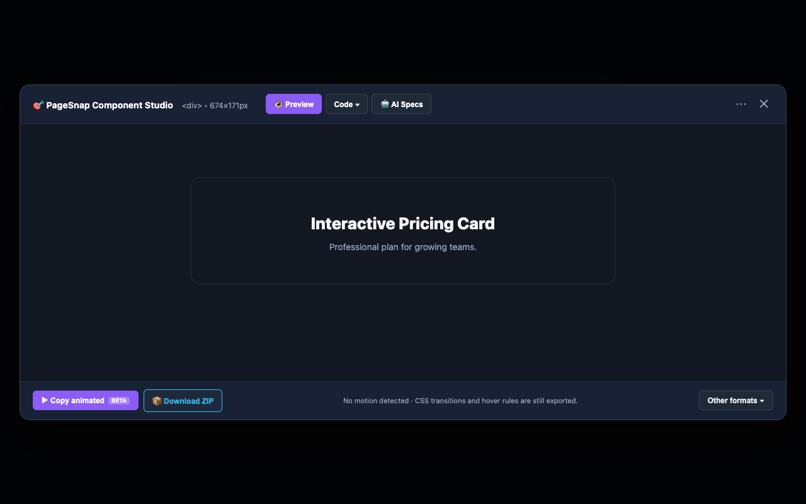
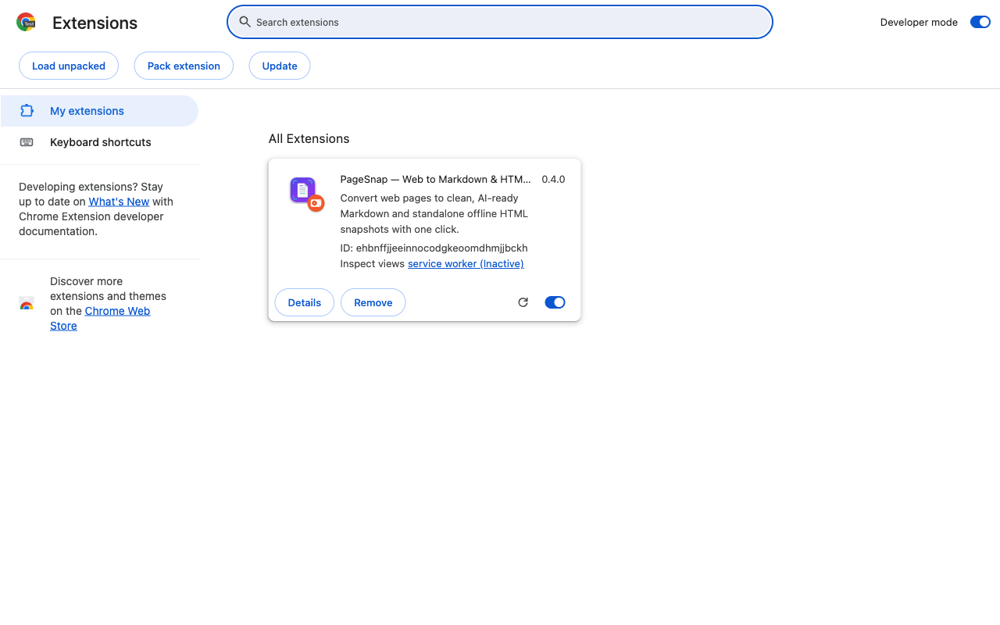

<!-- markdownlint-disable MD013 MD033 MD045 -->

<h1 align="center">
  <a href="https://github.com/HiepLeHoaiNghia/pagesnap"></a> PageSnap
</h1>

<p align="center">
  <a href="https://github.com/HiepLeHoaiNghia/pagesnap/releases/latest"></a>
  <a href="LICENSE"></a>
  
  
  
  
</p>

<p align="center">
  <strong>The 1-click web component clipper for AI code generation (Cursor, Claude Code, v0).</strong><br/>
  Extract any live UI component into clean, scoped HTML &amp; CSS, pure article Markdown, or an AI-ready design prompt package.
</p>

<h3 align="center">
  <a href="https://github.com/HiepLeHoaiNghia/pagesnap/releases/latest"><ins>Download PageSnap (Latest ZIP)</ins></a>
</h3>

<p align="center">
  
</p>
<p align="center">
  
</p>

---

## ⚡ Why PageSnap?

AI coding tools like **Cursor**, **Claude Code**, and **v0** build stunning interfaces, but feeding them raw browser inspect HTML often fails because of cluttered classes, global CSS leaks, and megabytes of junk.

PageSnap sits directly in your browser. With **1 click**, it extracts precisely the target component with computed layout, scoped styles, design tokens, and clean Markdown—ready to paste straight into your AI prompts.

| Capability | PageSnap (Free &amp; Open Source) | DivMagic / Xtractly ($35 - $60) | SingleFile / Web Clippers |
| :--- | :--- | :--- | :--- |
| **Pricing** | **100% Free &amp; Open Source (MIT)** | Paid license ($30 - $60+) | Free / Freemium |
| **Clean Markdown** | ✅ **Built-in** (via Mozilla Readability) | ❌ HTML only | ⚠️ Whole page only |
| **Scoped HTML + CSS** | ✅ **No global leaks** (`.ps-el-*`) | ✅ Scoped classes | ❌ Full page dump |
| **AI Design Prompt** | ✅ **Structured `AI-PROMPT.md`** | ❌ None | ❌ None |
| **Privacy &amp; Telemetry**| ✅ **100% Local in-browser** | ⚠️ Closed-source analytics | ⚠️ Third-party servers |
| **Network Hooks** | ✅ **Strictly passive** (Zero interference)| ⚠️ Invasive injection | ⚠️ Variable |
| **3D / Canvas Extraction**| 🧪 **Experimental (BETA)** | ❌ Unsupported | ❌ Static canvas only |

---

## 🌟 Core Features

### 📋 1-Click Clean Markdown Extraction
Extract clean article content or selected card text instantly. Powered by Mozilla's battle-tested Readability engine, PageSnap strips ads, cookie banners, navigation menus, and trackers.
- Formats tables, lists, and syntax-highlighted code blocks cleanly.
- Automatic YAML Frontmatter (`title`, `author`, `url`, `date`).
- Token estimation for GPT-4o and Claude 3.5 Sonnet.

### 🌐 Scoped HTML &amp; CSS (No-JS Mode)
Export components with fully isolated, scoped styles (`.ps-el-N`).
- Inherits typography, layout, Flexbox, and Grid faithfully.
- Strips invasive JavaScript so the exported component is safe and lightweight.
- Opens offline in any browser without broken dependencies.

### 🎮 Floating Actions Dock & Smart Coachmark
When hovering and clicking any live web element, PageSnap displays a compact, floating actions dock:
- **📋 Copy Markdown:** Clean GitHub-flavored Markdown for technical notes or Obsidian.
- **🌐 Copy HTML:** Scoped HTML & CSS without JavaScript (`.ps-el-N`).
- **🎮 Smart Game HUD Coachmark:** Interactive onboarding tutorial callout for static selections, explaining clean code export with a 1-click "Don't show again" preference.
- **••• More Actions:** Overflow menu with Download ZIP, AI Design Prompt, and Beta tools.

### 🛠️ Interactive Component Studio
Inspect, tweak, and customize before copying:
- **Preview Tab:** Interactive live sandbox showing the isolated component. Edit text directly on-screen!
- **Code Tab:** Multi-file code browser (`index.html`, `styles.css`, `Component.jsx`, `tokens.json`).
- **AI Specs Tab:** Copy ready-to-use reverse-engineering blueprints for AI agents (Cursor, Claude, v0).
- **Footer Actions:** 1-click **Copy animated (BETA)** and **Download ZIP** bundle.

### 🧪 Experimental Lab (BETA)
For rich media and creative web experiences:
- **▶ Copy animated (JS) [BETA]:** Replay pointer-driven SVG animations and CSS keyframes offline.
- **🎬 60fps Canvas Video Recording [BETA]:** Record smooth WebM loops of canvas animations via `captureStream()`.
- **🎨 3D WebGL Asset Packaging [BETA]:** Discover and bundle loaded 3D models (`.glb`), depth maps, and textures.
---

## 🚀 Quick Install (Load Unpacked in 60s)

PageSnap runs directly in any Chromium-based browser without terminal commands or build tools:

### Step 1: Download &amp; Unzip
1. Download [**`pagesnap-store-ready.zip`**](https://github.com/HiepLeHoaiNghia/pagesnap/releases/latest) from the latest release.
2. Unzip into a permanent folder on your computer (e.g., `Documents/pagesnap`).

### Step 2: Enable Developer Mode
1. Open Google Chrome, Microsoft Edge, or Brave.
2. Go to `chrome://extensions` in your address bar.
3. In the top-right corner, toggle **Developer mode** to **ON**.

<p align="center">
  
</p>

### Step 3: Load Unpacked Extension
1. In the top-left toolbar, click **Load unpacked**.
2. Select the unzipped folder containing `manifest.json`.

<p align="center">
  
</p>

### Step 4: Ready to Snap!
Pin **PageSnap** (📌) to your browser toolbar for instant 1-click access anytime!

<p align="center">
  
</p>

---

## ⌨️ Keyboard Shortcuts

| Shortcut | Action | Description |
| :--- | :--- | :--- |
| `F1` | **Convert Page** | Extract full article as clean Markdown or HTML snapshot |
| `F2` | **Inspect Region** | Hover and click any UI component to launch the Floating Dock |
| `F3` | **HTML Snapshot** | Capture standalone offline HTML snapshot of the current page |
| `▲ / ▼` | **Expand / Shrink** | In Inspect mode, expand to parent container or shrink to child |

---

## 🧪 Testing &amp; Verification

PageSnap is verified with an automated suite comprising static checks, contract integrity gates, and real-browser Chromium E2E tests:

```bash
# Run 13 architectural static checks and contract integrity tests
npm test

# Run UI contract test suite (Floating Dock, Studio tabs, overflow menu)
npm run test:e2e:ui

# Run full Chromium E2E smoke tests
npm run test:e2e
```

---

## 🔒 Permissions &amp; Privacy

| Permission | Justification |
| :--- | :--- |
| `activeTab` | Read content on the active tab only when you explicitly invoke the extension. |
| `clipboardWrite` | Copy formatted Markdown or scoped HTML directly to your clipboard. |
| `storage` | Save your preferred Markdown options (YAML frontmatter, raw mode). |
| `downloads` | Download component ZIP archives or video clips directly to your device. |
| `contextMenus` | Provide right-click "Copy selection as Markdown" shortcut. |

*PageSnap operates 100% locally in your browser. It does not collect, log, or transmit any browsing data or personal telemetry.*

---

## 🤝 Contributing

Contributions are welcome! Please read our [Contributing Guide](CONTRIBUTING.md) for local development workflows and coding standards.

---

## 📄 License

PageSnap is open-source software under the [MIT License](LICENSE).
