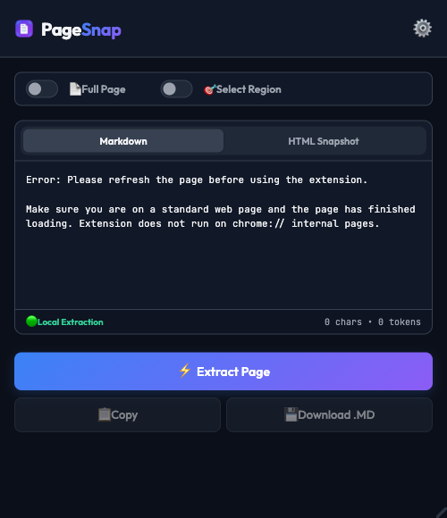

<!-- markdownlint-disable MD013 MD033 MD045 -->

<h1 align="center">
  <a href="https://github.com/HiepLeHoaiNghia/pagesnap"></a> PageSnap
</h1>

<p align="center">
  <a href="https://github.com/HiepLeHoaiNghia/pagesnap/releases/latest"></a>
  <a href="LICENSE"></a>
  
  
  
  
</p>

<p align="center">
  <strong>The privacy-first Web-to-Markdown clipper &amp; standalone offline HTML archiver.</strong><br/>
  Convert any web page or selected region into clean, AI-ready Markdown and standalone offline HTML snapshots with one click.
</p>

<h3 align="center">
  <a href="https://github.com/HiepLeHoaiNghia/pagesnap/releases/latest"><ins>Download PageSnap (Latest ZIP)</ins></a>
</h3>

<p align="center">
  
</p>

---

## Features

<table>
<tr>
<td width="50%" valign="top">

### ⚡ 1-Click Clean Markdown Extraction
Extract clean article content instantly. PageSnap uses Mozilla's battle-tested Readability engine to strip ads, popups, cookie banners, navigation menus, and footers, leaving only the pure content.

- Automatic YAML Frontmatter (`title`, `author`, `url`, `date`)
- Markdown tables & syntax-highlighted code blocks
- Real-time character count and LLM token estimation (GPT-4o / Claude 3.5 Sonnet)

</td>
<td width="50%" valign="top">

### 📦 Standalone Offline HTML Snapshot
Need an exact visual backup of the page? PageSnap serializes the full DOM into a self-contained offline HTML package.

- Cross-origin stylesheets and adopted sheets inlined recursively
- Images and web fonts converted directly to Base64
- Zero external dependencies or tracking scripts
- Viewable offline on any browser without internet connection

</td>
</tr>
<tr>
<td width="50%" valign="top">

### 🎯 Visual Region Selector
Don't need the entire web page? Activate the Visual Region Selector to hover and pick any specific element, comment thread, or data table directly on the live page.

- Hover outline with element boundary indicators
- One-click copy as Markdown or scoped HTML
- Export selected region as a standalone ZIP package

</td>
<td width="50%" valign="top">

### 🔒 100% Passive Zero-Interference
Unlike invasive extensions that monkey-patch global network APIs, PageSnap is strictly passive by default.

- Native `window.fetch` and `window.XMLHttpRequest` are never wrapped
- Zero persistent background scripts at `document_start`
- Injects scripts into the active tab only when explicitly clicked
- No blanket `<all_urls>` permission required

</td>
</tr>
</table>

---

## 🚀 Quick Install (Load Unpacked)

Installing PageSnap takes less than 60 seconds without writing code or using a terminal:

### Step 1: Download & Extract
1. Download [**`pagesnap-store-ready.zip`**](https://github.com/HiepLeHoaiNghia/pagesnap/releases/latest) from the latest release.
2. Extract (unzip) the archive into a permanent folder on your computer (e.g. your `Documents` folder).

---

### Step 2: Open Extensions Page & Enable Developer Mode
1. Open your browser and paste the following URL into your address bar, then press **Enter**:
   - **Google Chrome:** `chrome://extensions`
   - **Microsoft Edge:** `edge://extensions`
   - **Brave Browser:** `brave://extensions`
2. In the top-right corner of the Extensions page, switch the **Developer mode** toggle to **ON**.

<p align="center">
  
</p>

---

### Step 3: Click "Load unpacked" & Select Folder
1. In the top-left toolbar, click the **Load unpacked** button.
2. In the folder picker, select the **unzipped folder** that contains `manifest.json`.

<p align="center">
  
</p>

---

### Step 4: Extension Installed & Active
PageSnap will appear immediately in your extensions list, ready for 1-click capture.

<p align="center">
  
</p>

---

### Step 5: Pin for 1-Click Access (Recommended)
1. Click the **puzzle piece icon (🧩)** in your browser's top toolbar.
2. Click the **pin icon (📌)** next to **PageSnap** so the icon stays permanently visible for instant extraction.

---

## 🧪 Testing & Verification

PageSnap is verified with an automated test suite comprising static architectural checks and real-browser Chromium E2E integration tests:

```bash
# Run 10/10 static checks (manifest, bundles, ES modules, action registry)
npm test

# Run real-browser Chromium E2E smoke tests
npm run test:e2e

# Build production ZIP package for Chrome Web Store
npm run package
```

---

## 🔒 Permissions & Privacy

| Permission | Technical Justification |
| :--- | :--- |
| `activeTab` | Read content on the active tab only when you explicitly invoke the extension. |
| `clipboardWrite` | Copy formatted Markdown directly to your clipboard on click. |
| `storage` | Save your preferred Markdown options (YAML frontmatter, Obsidian wikilinks). |
| `downloads` | Save exported `.md` and `.html` files directly to your device. |
| `contextMenus` | Provide right-click "Copy region as Markdown" shortcut. |

*PageSnap operates 100% locally in your browser. It does not collect, log, or transmit your browsing activity.*

---

## 📄 License

PageSnap is open-source software under the [MIT License](LICENSE).
