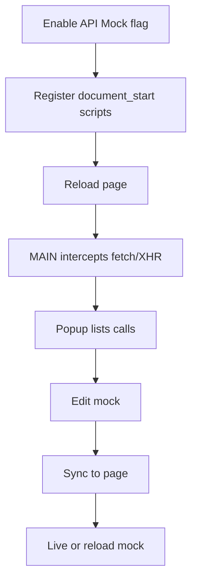

<!-- markdownlint-disable MD013 MD033 MD045 -->

# API Mocking

> Captures page `fetch`/XHR calls in the MAIN world and lets users edit mocked responses for live or reloaded page behavior.

  
  
  

Related: [README](../../../README.md) · [HTML Clone ZIP Netlify](../html-clone-zip-netlify/feature.md) · [Component Inspector](../component-inspector/feature.md)

---

## 🔍 1. Overview

|                   |                                                                                                                                                             |
| ----------------- | ----------------------------------------------------------------------------------------------------------------------------------------------------------- |
| **Scope**         | MAIN-world `fetch`/`XMLHttpRequest` interception, per-tab captured call list, mock editing, live mock sync, and clone-time mock stubs.                      |
| **Default state** | 🔴 `apiMock: false` in `src/shared/feature-flags.js`.                                                                                                       |
| **Activation**    | 🟡 Requires feature flag and page reload for document-start capture; Preserve JS controls whether mocks are enabled for clone/live setting sync.            |
| **Main limits**   | 🟡 Browser live smoke is manual-pending; static checks committed pass 10/10. Query bodies, binary payload fidelity, WebSocket, and SSE capture are limited. |

> [!IMPORTANT]
> API mocking is default off because it patches page-native `fetch` and `XMLHttpRequest` in the MAIN world.

---

## 🔄 2. How-To Flows

### Capture API calls

1. Enable **API mocking** in Features.
2. Reload the tab so `syncRegisteredScripts()` document-start scripts can run before page scripts.
3. Use the page normally or click **Extract Page**.
4. MAIN-world interceptor records method, URL, request headers/body where serializable, response status/headers/text, stack callers, and timestamp.
5. Popup API tab loads calls from the background per-tab store.

### Edit a mock in the popup

1. Open the API tab and select a captured call.
2. Edit method, status, and response body in the API editor.
3. Save changes; background updates `tabApiCalls[tabId]` and sends `syncMocks` to the content bridge.
4. MAIN-world matching uses method plus origin/path or URL containment and returns mocked fetch/XHR responses when mocking is enabled.

### Use mock data in an HTML clone

1. Enable **Preserve JS & Mock APIs**.
2. Extract the page.
3. Clone generation receives captured API calls and injects an offline mock interceptor into `scripts.js` or inline HTML.

---

## 🧪 3. QA Test Scenarios

### ✅ Happy paths

| #   | Scenario                           | Expected                                                            |
| --- | ---------------------------------- | ------------------------------------------------------------------- |
| H1  | Capture fetch after reload         | 🟢 API list shows method, URL, status, and response text.           |
| H2  | Capture XHR after reload           | 🟢 XHR call appears with headers and response text when accessible. |
| H3  | Save mock live                     | 🟢 Matching future fetch/XHR receives mocked status/body.           |
| H4  | Save & Reload from inspector modal | 🟢 Mock is stored then page reloads after short delay.              |

### 🔒 Permissions/world security

| Scenario            | Expected                                                                                                                 |
| ------------------- | ------------------------------------------------------------------------------------------------------------------------ |
| Feature disabled    | 🟡 Registered scripts are removed for future loads, but an already-open page remains patched until reload.               |
| Feature enabled     | 🟡 Reload after enabling so interception begins at `document_start`; reload after disabling to restore native fetch/XHR. |
| Page sensitive APIs | 🟡 Captured headers/bodies may include sensitive values; user must treat API tab/exports as sensitive.                   |

### ⚠️ Input/output validation

| Input/output          | Invalid condition                 | Expected                                                                     |
| --------------------- | --------------------------------- | ---------------------------------------------------------------------------- |
| Request body          | `FormData`                        | 🟡 Serialized to JSON object when possible; file fidelity is not preserved.  |
| Request/response body | Binary/stream                     | 🟡 Best-effort string/JSON only; binary is not faithfully mocked.            |
| WebSocket/SSE         | Live capture                      | 🟡 Not captured by live API store; offline clone stub blocks/logs them only. |
| URL query matching    | Same origin/path, different query | 🟡 Matching ignores query in primary path comparison.                        |

### 🚫 Feature interaction/business rules

| Scenario        | Expected                                                        |
| --------------- | --------------------------------------------------------------- |
| Preserve JS off | 🟡 `saveSettings()` sends mocking disabled state to active tab. |
| Reset API calls | 🟢 Background keeps user-edited mocks and removes other calls.  |
| Clear all mocks | 🟢 Mock flags reset and live page receives updated mock list.   |

### 🧾 Sensitive data/storage

| Data                     | Handling                                                                                 |
| ------------------------ | ---------------------------------------------------------------------------------------- |
| Captured calls           | 🟢 In-memory per tab in background `tabApiCalls`; cleared when tab closes.               |
| MAIN-world session mocks | 🟡 Stored in page `sessionStorage` as `web2md_api_mocks` and `web2md_mocking_enabled`.   |
| Request/response data    | 🟡 Headers and bodies are captured as-is when serializable; no redaction is implemented. |
| Browser smoke            | 🟡 Manual-pending; committed static checks pass 10/10.                                   |

---

## 📚 4. Reference

### Code paths

| Path                                  | Role                                                       |
| ------------------------------------- | ---------------------------------------------------------- |
| `src/main-world/api-interceptor.js`   | MAIN-world fetch/XHR patching, capture, mock matching.     |
| `src/background/injector.js`          | Dynamic and persistent document-start script registration. |
| `src/background/api-mock-store.js`    | Per-tab background call/mock store.                        |
| `src/content/mock-bridge/relay.js`    | Content bridge for mock/inspect messages.                  |
| `src/popup/api-mocks.js`              | Popup API list and editor UI.                              |
| `src/content/html-clone/mock-stub.js` | Offline clone mock interceptor.                            |

### Message/storage names

| Name                         | Type           | Purpose                             |
| ---------------------------- | -------------- | ----------------------------------- |
| `WEB2MD_SET_MOCKS`           | postMessage    | Push mock list into MAIN world.     |
| `WEB2MD_SET_MOCKING_ENABLED` | postMessage    | Enable/disable mock matching.       |
| `WEB2MD_API_CALL_RECORDED`   | postMessage    | MAIN world reports a captured call. |
| `web2md_api_mocks`           | sessionStorage | MAIN-world mock list cache.         |
| `web2md_mocking_enabled`     | sessionStorage | MAIN-world mocking toggle cache.    |

---

## 💡 5. Explanation

### Document-start registration protects early calls

Runtime injection after popup open misses APIs fired during app bootstrap. Persistent `document_start` registration is used when the feature flag is enabled so interception exists before page scripts run.

### Matching is intentionally broad and simple

> [!IMPORTANT]
> **Invariant:** Mock matching is method-aware, but primary URL comparison ignores query strings.

This makes common REST mocks easy to reuse but can overmatch endpoints that vary behavior only by query parameters.

---

## 📑 Changelog

| Date       | Entry                                                                                         |
| ---------- | --------------------------------------------------------------------------------------------- |
| 2026-07-30 | Documented as-built v0.2.0; browser smoke manual-pending; committed static checks pass 10/10. |
