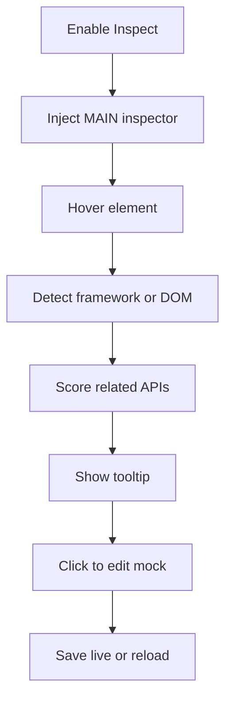

<!-- markdownlint-disable MD013 MD033 MD045 -->

# Component Inspector

> Provides an on-demand page overlay that identifies React/Vue/Angular/DOM elements and associates them with captured APIs for mock editing.

  
  
  

Related: [README](../../../README.md) · [API Mocking](../api-mocking/feature.md) · [Region Selection](../region-selection/feature.md) · [Visual Edit](../visual-edit/feature.md) · [React VFS Project Detection](../react-vfs-project-detection/feature.md)

---

## 🔍 1. Overview

|                      |                                                                                                                               |
| -------------------- | ----------------------------------------------------------------------------------------------------------------------------- |
| **Scope**            | Inspect overlay, framework detection, selector fallback, API association, and shadow-DOM mock editor modal.                   |
| **Default state**    | 🔴 `inspect: false` in `src/shared/feature-flags.js`.                                                                         |
| **Detection layers** | 🟢 React Fiber/internal instance, Vue 2/3 instance markers, Angular context/ng helpers, then DOM selector/ARIA fallback.      |
| **Main limits**      | 🟡 Browser live smoke is manual-pending; static checks committed pass 10/10. Framework QA is manual-pending across real apps. |

> [!NOTE]
> Inspector is on-demand. If the content script is not ready, the popup injects API, VFS, and inspector MAIN-world parts before retrying.

---

## 🔄 2. How-To Flows

### Inspect a component

1. Enable **Inspect** in the popup toolbar.
2. Move the pointer over a page element.
3. MAIN-world inspector draws `#web2md-highlighter` and `#web2md-tooltip`.
4. Tooltip shows selector, framework/component when detected, and up to five associated APIs.
5. Click the element or tooltip to open the API Mock Editor modal.

### Edit an associated API

1. Open the modal from an inspected element.
2. Choose an associated API or any captured API from the dropdown.
3. Edit status/body, format JSON if needed, reset to original, then save.
4. `WEB2MD_UPDATE_MOCK_SAVE` relays the mock to background through the content bridge.

### Use without framework metadata

1. Inspect any vanilla DOM element.
2. DOM fallback shows selector path, `role`, and `aria-label` when available.
3. API association can still come from temporal or content matching.

---

## 🧪 3. QA Test Scenarios

### ✅ Happy paths

| #   | Scenario                              | Expected                                                                                      |
| --- | ------------------------------------- | --------------------------------------------------------------------------------------------- |
| H1  | Hover React component with Fiber keys | 🟢 Tooltip shows React component name when available.                                         |
| H2  | Hover Vue/Angular component markers   | 🟡 Framework details appear when app exposes recognized markers; framework QA manual-pending. |
| H3  | Hover vanilla DOM                     | 🟢 Tooltip shows selector/ARIA fallback.                                                      |
| H4  | Click tooltip with captured API       | 🟢 Shadow modal opens and saves mock through background.                                      |

### 🔒 Permissions/world security

| Scenario                  | Expected                                                                       |
| ------------------------- | ------------------------------------------------------------------------------ |
| Run on Chrome system page | 🟢 Popup blocks with `Cannot inspect Chrome system pages.`                     |
| Inspect overlay clicked   | 🟢 Overlay clicks do not recursively inspect Web2MD UI.                        |
| Feature disabled          | 🟢 Inspect UI hidden; MAIN inspector is not injected unless requested/enabled. |

### ⚠️ Input/output validation

| Input/output        | Invalid condition                 | Expected                                                             |
| ------------------- | --------------------------------- | -------------------------------------------------------------------- |
| API body formatting | Invalid JSON                      | 🟡 Toast shows `Invalid JSON: Cannot Format`; text remains editable. |
| No API history      | Empty `window.__web2md_api_calls` | 🟡 Modal dropdown shows `No captured API calls found`.               |
| Component metadata  | Minified/production app           | 🟡 Falls back to unknown component or DOM selector.                  |

### 🚫 Feature interaction/business rules

| Scenario                             | Expected                                                          |
| ------------------------------------ | ----------------------------------------------------------------- |
| Enable while Region Selection active | 🟢 Region selection is disabled.                                  |
| Enable while Visual Edit active      | 🟢 Visual Edit is disabled.                                       |
| API association for an early call    | 🟡 No association exists unless API history was captured earlier. |

### 🧾 Sensitive data/storage

| Data                      | Handling                                                        |
| ------------------------- | --------------------------------------------------------------- |
| API responses in modal    | 🟡 Shows captured response text as-is; no redaction.            |
| Component names/selectors | 🟢 In page memory only unless user saves/exports related mocks. |
| Modal host                | 🟢 Created as `#web2md-modal-root` with shadow DOM isolation.   |
| Browser smoke             | 🟡 Manual-pending; committed static checks pass 10/10.          |

---

## 📚 4. Reference

### Code paths

| Path                                | Role                                                        |
| ----------------------------------- | ----------------------------------------------------------- |
| `src/main-world/inspector.js`       | Framework detection, API scoring, overlay/tooltip/modal UI. |
| `src/main-world/api-interceptor.js` | Provides API history and enrichment hook integration.       |
| `src/content/mock-bridge/relay.js`  | Toggle relay and mock-save relay.                           |
| `src/popup/mode-toggles.js`         | Popup Inspect toggle and mutual exclusion.                  |
| `src/background/api-mock-store.js`  | Persists saved mocks in per-tab memory.                     |

### Scoring sources

| Source         | Score contribution       | Notes                                  |
| -------------- | ------------------------ | -------------------------------------- |
| Stack trace    | 🟢 Up to 30              | Component name in caller function.     |
| Temporal event | 🟡 20 exact / 10 related | DOM event within 500 ms.               |
| Content match  | 🟡 5                     | Element text appears in response text. |

---

## 💡 5. Explanation

### Inspector depends on API history

The inspector does not make new network requests to discover APIs. It correlates elements against the captured API ring/history supplied by the MAIN-world interceptor.

### Framework detection is best-effort

> [!IMPORTANT]
> **Invariant:** When framework-specific metadata is missing, the inspector must still provide a useful DOM fallback.

Production builds often minify component names or hide debug source data. The fallback selector/ARIA view keeps the tool usable without framework internals.

---

## 📑 Changelog

| Date       | Entry                                                                                         |
| ---------- | --------------------------------------------------------------------------------------------- |
| 2026-07-30 | Documented as-built v0.2.0; browser smoke manual-pending; committed static checks pass 10/10. |
