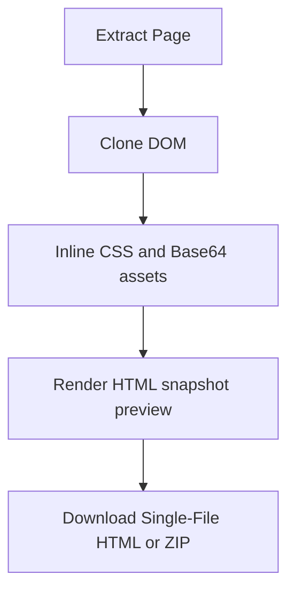

<!-- markdownlint-disable MD013 MD033 MD045 -->

# HTML Clone & Standalone Snapshot

> Exports the active page as a clean self-contained HTML snapshot or standalone ZIP package without script or network interference.

  
  
  

Related: [README](../../../README.md) · [Markdown & HTML Extraction](../markdown-html-extraction/feature.md) · [Region Selection](../region-selection/feature.md)

---

## 🔍 1. Overview

|                   |                                                                                                                                                                        |
| ----------------- | ---------------------------------------------------------------------------------------------------------------------------------------------------------------------- |
| **Scope**         | Self-contained HTML, popup preview iframe, ZIP package, inlined stylesheets and Base64 assets. Netlify and offline mock stubs have been removed in v0.3.0. |
| **Default state** | 🟢 `htmlClone: true` in `src/shared/feature-flags.js`.                                                                                                                 |
| **Output modes**  | 🟢 Single HTML for preview/download; popup ZIP with `index.html` and inlined assets.                                                                                   |
| **Main limits**   | 🟢 Verified via automated E2E browser tests (4/4 pass) and static checks (10/10 pass). External fetches can fail by network/CORS/protection.                            |

> [!NOTE]
> The preview iframe uses `sandbox="allow-same-origin"` for clean and isolated rendering.
---

## 🔄 2. How-To Flows

### Generate an HTML clone

1. Keep **HTML clone & ZIP** enabled in Features.
2. Click **Extract Page**.
3. `clonePage` calls `serializePageToSelfContainedHtml` before Markdown rendering finishes.
4. The popup stores `appState.currentHtml` and `appState.currentPackage` and renders the HTML preview tab.

### Download ZIP package

1. After extraction, click **Download HTML** (or export region as ZIP).
2. Popup `buildZipBlob()` writes structured files from `appState.currentPackage`.
3. The ZIP filename is `<sanitized-title>-snapshot.zip`.
---

## 🧪 3. QA Test Scenarios

### ✅ Happy paths

| #   | Scenario                        | Expected                                                                                            |
| --- | ------------------------------- | --------------------------------------------------------------------------------------------------- |
| H1  | Extract with HTML clone flag on | 🟢 HTML tab has `srcdoc`; Download buttons become enabled.                                          |
| H2  | Download ZIP with CSS/images    | 🟢 ZIP contains `index.html`, `styles.css`, and mapped `assets/asset_N.ext` files.                  |
### 🔒 Permissions/world security

| Scenario                   | Expected                                                                            |
| -------------------------- | ----------------------------------------------------------------------------------- |
| Tracker scripts present    | 🟢 Known analytics/tracker URLs are skipped by `TRACKER_REGEX`.                     |
| External asset fetch fails | 🟡 Clone continues with original URL or failure comment depending on resource type. |

### ⚠️ Input/output validation

| Input/output   | Invalid condition   | Expected                                                                        |
| -------------- | ------------------- | ------------------------------------------------------------------------------- |
| ZIP package    | No `currentPackage` | 🟡 Falls back to plain `index.html` from `currentHtml`.                         |
| CSS `url(...)` | Relative path       | 🟢 Resolved against stylesheet/page URL, then mapped to data URL or `assets/*`. |
| Canvas         | Serializable canvas | 🟢 Converted to PNG image; tainted canvas is skipped.                           |

### 🚫 Feature interaction/business rules

| Scenario             | Expected                                                                                                                                        |
| -------------------- | ----------------------------------------------------------------------------------------------------------------------------------------------- |
| Region export        | 🟢 Serializer receives `targetElement` and builds region-only HTML/package.                                                                     |
| Preserve JS disabled | 🟢 Scripts are omitted from standalone snapshot. |

### 🧾 Sensitive data/storage

| Data          | Handling                                                                              |
| ------------- | ------------------------------------------------------------------------------------- |
| Cloned HTML   | 🟢 Captures current visible DOM/styles by user action.                                |
| Browser smoke | 🟢 Automated Playwright E2E tests pass 4/4 (`tests/e2e/e2e-smoke.mjs`).              |

---

## 📚 4. Reference

### Code paths

| Path                                    | Role                                                                |
| --------------------------------------- | ------------------------------------------------------------------- |
| `src/content/html-clone/serializer.js`  | DOM, CSS, asset, shadow DOM, canvas, form-state serialization.       |
| `src/content/html-clone/zip-builder.js` | Content-script region ZIP builder.                                  |
| `src/popup/html-clone.js`               | Popup ZIP blob creation and standalone package download.            |
| `src/background/asset-proxy.js`         | Background fetch proxy for stylesheets and assets.                  |
| `src/popup/extract.js`                  | Clone orchestration and preview iframe sandbox.                     |

### ZIP structure

| Path                 | Condition                                 | Content                                     |
| -------------------- | ----------------------------------------- | ------------------------------------------- |
| `index.html`         | 🟢 Always                                 | Structured HTML document.                   |
| `styles.css`         | 🟡 CSS exists                             | Document-level CSS and adopted stylesheets. |
| `assets/asset_N.ext` | 🟡 Assets fetched                         | Images/fonts/background assets as files.    |

---

## 💡 5. Explanation

### Two clone shapes serve different uses

Self-contained HTML is optimized for immediate preview/download, while structured ZIP is optimized for deployment and file inspection. The popup keeps its own ZIP builder because it must also fold in VFS project files and use direct download/deploy blobs.

---

## 📑 Changelog

| Date       | Entry                                                                                         |
| ---------- | --------------------------------------------------------------------------------------------- |
| 2026-07-30 | Documented as-built v0.2.0; browser smoke manual-pending; committed static checks pass 10/10. |
| 2026-10-23 | Refactored in v0.3.0: removed Netlify deployment and mock interceptor stubs; simplified to clean standalone snapshot and ZIP package; verified via E2E browser smoke tests. |
