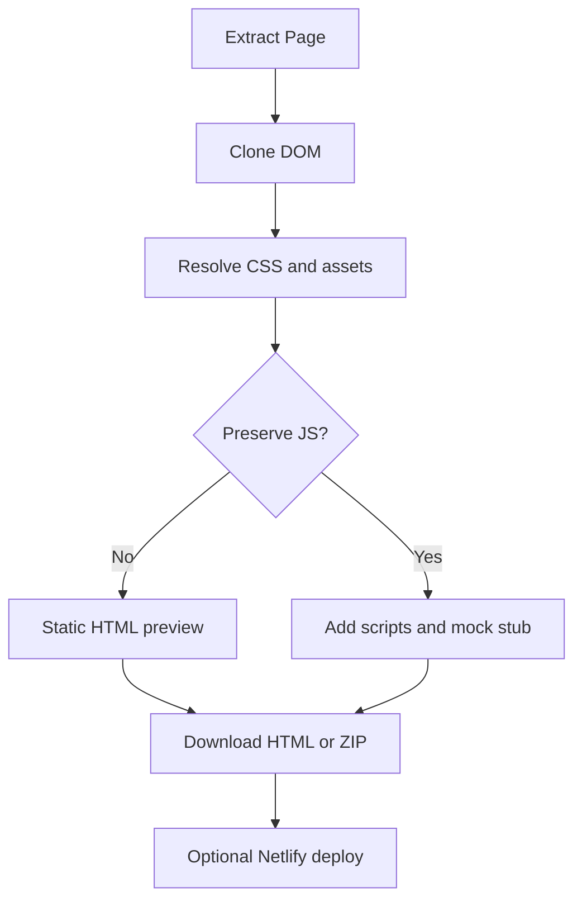

<!-- markdownlint-disable MD013 MD033 MD045 -->

# HTML Clone, ZIP Package & Netlify Deploy

> Exports the active page as a self-contained HTML preview, structured ZIP package, or Netlify deployment.

  
  
  

Related: [README](../../../README.md) · [Markdown & HTML Extraction](../markdown-html-extraction/feature.md) · [Region Selection](../region-selection/feature.md) · [API Mocking](../api-mocking/feature.md) · [React VFS Project Detection](../react-vfs-project-detection/feature.md)

---

## 🔍 1. Overview

|                   |                                                                                                                                                                        |
| ----------------- | ---------------------------------------------------------------------------------------------------------------------------------------------------------------------- |
| **Scope**         | Self-contained HTML, popup preview iframe, ZIP package, external asset fetching, optional JS preservation/API mock stub, and Netlify upload.                           |
| **Default state** | 🟢 `htmlClone: true` in `src/shared/feature-flags.js`.                                                                                                                 |
| **Output modes**  | 🟢 Single HTML for preview/download; popup ZIP with `index.html`, optional `styles.css`/`scripts.js`/`assets/*`; region ZIP may additionally include `mock_apis.json`. |
| **Main limits**   | 🟡 Browser live smoke is manual-pending; static checks committed pass 10/10. External fetches can fail by network/CORS/protection.                                     |

> [!NOTE]
> The preview iframe uses `sandbox="allow-same-origin"`; when **Preserve JS & Mock APIs** is enabled it becomes `sandbox="allow-scripts allow-same-origin"`.

---

## 🔄 2. How-To Flows

### Generate an HTML clone

1. Keep **HTML clone & ZIP** enabled in Features.
2. Click **Extract Page**.
3. `clonePage` calls `serializePageToSelfContainedHtml` before Markdown rendering finishes.
4. The popup stores `appState.currentHtml` and `appState.currentPackage` and renders the HTML preview tab.

### Download ZIP package

1. After extraction, click **ZIP Package**.
2. Popup `buildZipBlob()` writes structured files from `appState.currentPackage`.
3. If project files were detected, they are folded into the same ZIP using their original paths.
4. The ZIP filename is `<sanitized-title>-package.zip`.

### Deploy to Netlify

1. Enter a Netlify Personal Access Token in Settings.
2. Click **Deploy Netlify** after extraction.
3. The popup creates or reuses a site ID keyed as `netlifySiteId_${encodeURIComponent(pageUrl)}`.
4. It uploads the ZIP to `/api/v1/sites/{siteId}/deploys` and opens the resulting site URL.

> [!IMPORTANT]
> Netlify PAT storage is local-only. `localOnlyStorage.migrateFromSync('netlifyToken')` moves any legacy synced token into `chrome.storage.local` and removes the synced copy.

---

## 🧪 3. QA Test Scenarios

### ✅ Happy paths

| #   | Scenario                        | Expected                                                                                            |
| --- | ------------------------------- | --------------------------------------------------------------------------------------------------- |
| H1  | Extract with HTML clone flag on | 🟢 HTML tab has `srcdoc`; ZIP/Deploy buttons become enabled.                                        |
| H2  | Download ZIP with CSS/images    | 🟢 ZIP contains `index.html`, `styles.css`, and mapped `assets/asset_N.ext` files.                  |
| H3  | Preserve JS on                  | 🟢 `scripts.js` includes mock interceptor plus non-tracker scripts; preview sandbox allows scripts. |
| H4  | Deploy same page twice          | 🟢 Existing page-specific site ID is reused if still valid.                                         |

### 🔒 Permissions/world security

| Scenario                   | Expected                                                                            |
| -------------------------- | ----------------------------------------------------------------------------------- |
| Missing Netlify token      | 🟢 Settings pane opens, token input focuses, and deploy does not start.             |
| Tracker scripts present    | 🟢 Known analytics/tracker URLs are skipped by `TRACKER_REGEX`.                     |
| External asset fetch fails | 🟡 Clone continues with original URL or failure comment depending on resource type. |

### ⚠️ Input/output validation

| Input/output   | Invalid condition   | Expected                                                                        |
| -------------- | ------------------- | ------------------------------------------------------------------------------- |
| ZIP package    | No `currentPackage` | 🟡 Falls back to plain `index.html` from `currentHtml`.                         |
| CSS `url(...)` | Relative path       | 🟢 Resolved against stylesheet/page URL, then mapped to data URL or `assets/*`. |
| Canvas         | Serializable canvas | 🟢 Converted to PNG image; tainted canvas is skipped.                           |

### 🚫 Feature interaction/business rules

| Scenario             | Expected                                                                                                                                        |
| -------------------- | ----------------------------------------------------------------------------------------------------------------------------------------------- |
| Region export        | 🟢 Serializer receives `targetElement` and builds region-only HTML/package.                                                                     |
| Preserve JS disabled | 🟢 Scripts are omitted and API mock interceptor is not added to clone.                                                                          |
| API calls captured   | 🟢 Preserve-JS popup clone embeds the interceptor in `scripts.js`; only the content-side region ZIP builder writes a separate `mock_apis.json`. |

### 🧾 Sensitive data/storage

| Data          | Handling                                                                              |
| ------------- | ------------------------------------------------------------------------------------- |
| Netlify token | 🟢 Stored in `chrome.storage.local` only via `localOnlyStorage`.                      |
| Site ID       | 🟡 Stored through `safeStorage` under a page URL-specific key to sync reuse behavior. |
| Cloned HTML   | 🟡 Captures current visible DOM/form state by user action.                            |
| Browser smoke | 🟡 Manual-pending; committed static checks pass 10/10.                                |

---

## 📚 4. Reference

### Code paths

| Path                                    | Role                                                                |
| --------------------------------------- | ------------------------------------------------------------------- |
| `src/content/html-clone/serializer.js`  | DOM, CSS, JS, asset, shadow DOM, canvas, form-state serialization.  |
| `src/content/html-clone/zip-builder.js` | Content-script region ZIP builder.                                  |
| `src/content/html-clone/mock-stub.js`   | Offline fetch/XHR/WebSocket/EventSource mock interceptor generator. |
| `src/popup/html-clone.js`               | Popup ZIP blob creation and Netlify deploy flow.                    |
| `src/background/asset-proxy.js`         | Background fetch proxy for CSS, scripts, and assets.                |
| `src/popup/extract.js`                  | Clone orchestration and preview iframe sandbox.                     |

### ZIP structure

| Path                 | Condition                                 | Content                                     |
| -------------------- | ----------------------------------------- | ------------------------------------------- |
| `index.html`         | 🟢 Always                                 | Structured HTML document.                   |
| `styles.css`         | 🟡 CSS exists                             | Document-level CSS and adopted stylesheets. |
| `scripts.js`         | 🟡 Preserve JS enabled and JS exists      | Mock interceptor plus non-tracker scripts.  |
| `assets/asset_N.ext` | 🟡 Assets fetched                         | Images/fonts/background assets as files.    |
| `mock_apis.json`     | 🟡 API calls passed to region ZIP builder | Captured API calls for offline reference.   |

---

## 💡 5. Explanation

### Two clone shapes serve different uses

Self-contained HTML is optimized for immediate preview/download, while structured ZIP is optimized for deployment and file inspection. The popup keeps its own ZIP builder because it must also fold in VFS project files and use direct download/deploy blobs.

### Local-only token handling is a security invariant

> [!IMPORTANT]
> **Invariant:** Personal Access Tokens must not be written to synced storage.

The migration path removes legacy synced tokens after moving them locally, reducing accidental token propagation across Chrome profiles.

---

## 📑 Changelog

| Date       | Entry                                                                                         |
| ---------- | --------------------------------------------------------------------------------------------- |
| 2026-07-30 | Documented as-built v0.2.0; browser smoke manual-pending; committed static checks pass 10/10. |
