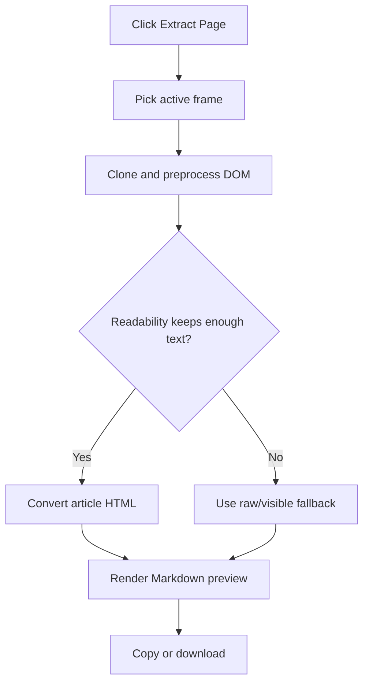

<!-- markdownlint-disable MD013 MD033 MD045 -->

# Markdown & HTML Extraction

> Converts the active web page or selected text into AI-ready Markdown, with optional HTML clone output from the same extraction pass.

  
  
  

Related: [README](../../../README.md) · [Region Selection](../region-selection/feature.md) · [HTML Clone ZIP Netlify](../html-clone-zip-netlify/feature.md) · [React VFS Project Detection](../react-vfs-project-detection/feature.md)

---

## 🔍 1. Overview

|                     |                                                                                                                                                                     |
| ------------------- | ------------------------------------------------------------------------------------------------------------------------------------------------------------------- |
| **Scope**           | Extract page content, selected text, Markdown preview, copy, and `.md` download from the Chrome extension popup/content scripts.                                    |
| **Default state**   | 🟢 `markdown: true` in `src/shared/feature-flags.js`; this feature is the always-on core path.                                                                      |
| **Source of truth** | 🟢 A cloned DOM is preprocessed before Readability/Turndown conversion; the live page is not mutated by extraction.                                                 |
| **Main limits**     | 🟡 Browser live smoke is manual-pending; static checks committed pass 10/10. Restricted `chrome://`, `chrome-extension://`, and Chrome Web Store pages are blocked. |

> [!NOTE]
> Extraction measures visible text against converted Markdown. If Markdown is under 15% of visible text on a large page, the popup/content fallback uses structured visible text to avoid losing complex app UI content.

---

## 🔄 2. How-To Flows

### Extract a page to Markdown

1. Open the popup on a normal web page and click **Extract Page**.
2. `src/popup/extract.js` selects a target frame by focused frame first, then largest `document.body.innerHTML`.
3. `extractContent` runs in the content script and returns title, content, rawContent, visibleText, URL, and Readability metadata.
4. The popup converts HTML through `convertHtmlToMarkdown`; if content script conversion is unavailable, it falls back to the popup-loaded Turndown pipeline.
5. Use **Copy** or **Download** to export the active preview tab.

### Convert selected text

1. Select visible page text.
2. Trigger the content handler `convertSelection`.
3. The selected range is cloned, preprocessed, converted with current settings, and copied to clipboard.

### Preserve page context in output

1. Enable **Include YAML Frontmatter** to add title, URL, date, author when available, and site.
2. Enable **Full Page (Skip Readability)** to convert `rawContent` instead of article content.
3. Configure **Keep Images**, **Keep Links**, and **Obsidian-friendly Wikilinks** before conversion.

> [!TIP]
> Use **Full Page (Skip Readability)** for dashboards and form-heavy pages where article extraction intentionally discards navigation or controls.

---

## 🧪 3. QA Test Scenarios

### ✅ Happy paths

| #   | Scenario                                                   | Expected                                                                                              |
| --- | ---------------------------------------------------------- | ----------------------------------------------------------------------------------------------------- |
| H1  | Extract readable article page                              | 🟢 Markdown preview renders, stats update, `preview-mode` shows `Article Mode`.                       |
| H2  | Extract dashboard-like page with little Readability output | 🟢 Visible text fallback preserves headings, labels, buttons, form values, and checkbox/radio states. |
| H3  | Copy/download Markdown                                     | 🟢 Clipboard receives active Markdown; download filename uses sanitized page title plus `.md`.        |
| H4  | Convert selected text                                      | 🟢 Selection is copied as Markdown with current settings.                                             |

### 🔒 Permissions/world security

| Scenario                  | Expected                                                                                                 |
| ------------------------- | -------------------------------------------------------------------------------------------------------- |
| Run on Chrome system page | 🟢 Popup shows unsupported-page error; no injection continues.                                           |
| Content script not loaded | 🟢 Background injection retries through `ensureInjected`; user sees refresh guidance if injection fails. |
| MAIN VFS scanner absent   | 🟢 Extraction falls back after 500 ms and still returns normal page Markdown.                            |

### ⚠️ Input/output validation

| Input/output   | Invalid condition                         | Expected                                                       |
| -------------- | ----------------------------------------- | -------------------------------------------------------------- |
| Selection      | Empty selection                           | 🟡 Toast says `Please select text first!`; no clipboard write. |
| Password input | Any current password value                | 🟢 Markdown/form fallback uses `[ •••••• ]`.                   |
| Image output   | Transparent 1x1/spacer or images disabled | 🟢 Image omitted from Markdown.                                |
| Link output    | Links disabled                            | 🟢 Link text remains without Markdown link syntax.             |

### 🚫 Feature interaction/business rules

| Scenario               | Expected                                                                                                           |
| ---------------------- | ------------------------------------------------------------------------------------------------------------------ |
| HTML Clone feature off | 🟢 Markdown extraction still works; `currentHtml` and `currentPackage` remain empty/null.                          |
| Project detection on   | 🟢 VFS scan is requested first; project files attach to extraction result when found.                              |
| Raw mode on            | 🟢 Conversion uses raw content when available, otherwise extracted content; `preview-mode` shows `Full Page Mode`. |

### 🧾 Sensitive data/storage

| Data            | Handling                                                                                                           |
| --------------- | ------------------------------------------------------------------------------------------------------------------ |
| Form values     | 🟡 Non-password inputs are represented as visible values because extraction is user-triggered.                     |
| Password fields | 🟢 Masked as `[ •••••• ]` before Markdown output.                                                                  |
| Settings        | 🟢 Stored under `settings` in `chrome.storage.sync` through `src/popup/state.js` / `src/content/core/settings.js`. |
| Browser smoke   | 🟡 Manual-pending; committed static checks pass 10/10.                                                             |

---

## 📚 4. Reference

### Code paths

| Path                                            | Role                                                                              |
| ----------------------------------------------- | --------------------------------------------------------------------------------- |
| `src/popup/extract.js`                          | Active tab/frame selection, extraction orchestration, preview, copy, download.    |
| `src/content/markdown/extractor.js`             | Readability parse, raw fallback, visible form fallback, VFS request bridge.       |
| `src/content/markdown/dom-preprocess.js`        | Form value sync, password masking, layout table flattening, data table detection. |
| `src/content/markdown/turndown-config.js`       | Turndown/GFM setup, link/image/table/code rules, frontmatter.                     |
| `src/content/markdown/handlers.js`              | `extractContent`, `convertSelection`, `convertPage`, `convertHtmlToMarkdown`.     |
| `lib/readability.js`                            | Mozilla Readability parser loaded before content modules.                         |
| `lib/turndown.js`, `lib/turndown-plugin-gfm.js` | Markdown conversion with GFM table support.                                       |

### Settings

| Setting key     | UI label                     | Default  | Effect                                                          |
| --------------- | ---------------------------- | :------: | --------------------------------------------------------------- |
| `frontmatter`   | Include YAML Frontmatter     | 🔴 false | Adds title, URL, date, author, site metadata.                   |
| `rawMode`       | Full Page (Skip Readability) | 🔴 false | Converts raw page body instead of article body.                 |
| `includeImages` | Keep Images                  | 🟢 true  | Keeps non-spacer images as Markdown image syntax.               |
| `includeLinks`  | Keep Links                   | 🟢 true  | Keeps links as Markdown links.                                  |
| `obsidianMode`  | Obsidian-friendly Wikilinks  | 🔴 false | Converts relative/anchor links into wikilinks.                  |
| `preserveJs`    | Preserve JS & Mock APIs      | 🔴 false | Affects HTML clone/API mocking, not Markdown conversion itself. |

### User-facing messages

| Message                                                         | Trigger                                      |
| --------------------------------------------------------------- | -------------------------------------------- |
| `Extraction not supported on Chrome system pages or Web Store.` | Popup blocks restricted URL extraction.      |
| `Could not connect to page. Refresh the page and try again.`    | Retry injection cannot reach content script. |
| `Page copied as Markdown!`                                      | Content handler copies whole page.           |
| `Selection copied as Markdown!`                                 | Content handler copies selected range.       |

---

## 💡 5. Explanation

### Preprocessed clone is the extraction source of truth

Extraction clones the DOM first, then synchronizes live form state into that clone and preprocesses form controls. This preserves current UI state without writing extraction artifacts back into the active page.

### Readability is useful but not authoritative

> [!IMPORTANT]
> **Invariant:** Large visible pages must not produce tiny Markdown silently.

Readability is preferred for article pages, but app dashboards often look like non-article boilerplate to Readability. The 15% visible-text heuristic protects users from empty-looking output when the actual page contains meaningful UI text.

### Data tables and layout tables take different paths

Layout tables with form controls are flattened into aligned text, while data-like tables are emitted as Markdown tables through the GFM plugin/custom table rule. This avoids turning form layouts into noisy grid syntax while keeping real tabular data scannable.

---

## 📑 Changelog

| Date       | Entry                                                                                         |
| ---------- | --------------------------------------------------------------------------------------------- |
| 2026-07-30 | Documented as-built v0.2.0; browser smoke manual-pending; committed static checks pass 10/10. |
