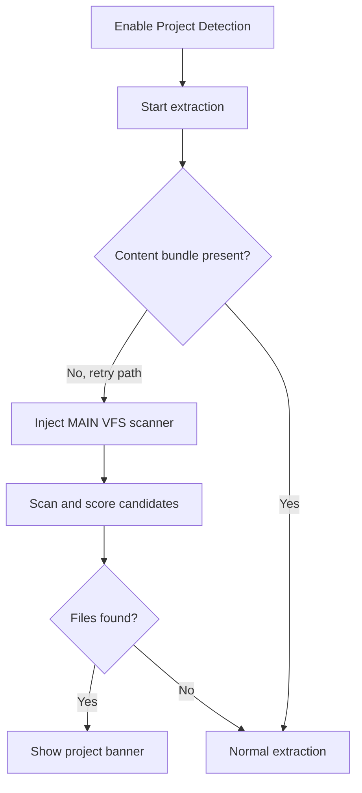

<!-- markdownlint-disable MD013 MD028 MD033 MD045 -->

# React VFS Project Detection

> Detects in-browser virtual file systems from globals, React Fiber trees, and shadow DOM, then exports project source as Markdown or ZIP.

  
  
  

Related: [README](../../../README.md) · [Markdown & HTML Extraction](../markdown-html-extraction/feature.md) · [HTML Clone ZIP Netlify](../html-clone-zip-netlify/feature.md) · [Component Inspector](../component-inspector/feature.md)

---
> [!IMPORTANT]
> **Migration Notice (v0.3.0):** This feature has been removed from `web2md-extension` and spun off into the dedicated developer repository **`pagereplica-extension`** (`/Users/hiepleh.n/p-source/pagereplica-extension`).

## 🔍 1. Overview

|                   |                                                                                                                                                                                                                      |
| ----------------- | -------------------------------------------------------------------------------------------------------------------------------------------------------------------------------------------------------------------- |
| **Scope**         | Optional MAIN-world VFS scanner, project files returned with the current extraction, project banner, all-files Markdown download, and ZIP inclusion.                                                                 |
| **Default state** | 🔴 `projectDetect: false` in `src/shared/feature-flags.js`.                                                                                                                                                          |
| **Scan triggers** | 🟡 Extraction posts `WEB2MD_REQUEST_VFS_SCAN`, but MAIN-world VFS injection currently occurs only on the extraction retry path or through Inspect injection. `window.web2mdScan()` exists only after that injection. |
| **Main limits**   | 🟡 Browser live smoke is manual-pending; static checks committed pass 10/10. Scan falls back after 500 ms if MAIN world does not respond.                                                                            |

> [!NOTE]
> The scanner runs in the MAIN world because React Fiber properties and app globals are not reliably visible from the isolated extension world.

---

## 🔄 2. How-To Flows

### Detect project files during extraction

1. Enable **Project detection** in Features before the content bundle is loaded in the target tab.
2. On a fresh/reloaded tab, click **Extract Page**. If the initial content message fails, the retry path requests MAIN-world VFS parts with `{ vfs: true }`.
3. Content script posts `WEB2MD_REQUEST_VFS_SCAN` before extracting page content.
4. MAIN-world scanner returns normalized `{ path, content }` files or an empty list.
5. The content extractor attaches those files directly to the current extraction response; the popup shows `Project Detected (N files)` from that response.

> [!NOTE]
> A background `registerProject`/`getProject` store exists, but the current VFS response flow does not emit the separate registration message it listens for. Do not rely on project files surviving beyond the current popup extraction state.

> [!WARNING]
> If the base content bundle already responds to `extractContent`, the current popup flow does not call the VFS injector. The request times out after 500 ms and normal extraction continues. Reload the tab before the flow above, or enable/toggle Inspect once because its on-demand path also injects the VFS scanner.

### Download project Markdown

1. After a successful detection, click **Download Project** in the banner.
2. `downloadProjectMarkdown()` writes a project structure list plus one fenced code block per file.
3. The filename is `<sanitized-title>-all-files.md`.

### Include project files in ZIP

1. Extract with both Project Detection and HTML Clone enabled.
2. Click **ZIP Package**.
3. Popup ZIP builder adds each detected file at its original `file.path` alongside clone files.

---

## 🧪 3. QA Test Scenarios

### ✅ Happy paths

| #   | Scenario                                                  | Expected                                                                      |
| --- | --------------------------------------------------------- | ----------------------------------------------------------------------------- |
| H1  | Detect object-map VFS with code-like keys                 | 🟢 Files normalize to `{ path, content }` and banner appears.                 |
| H2  | Detect array VFS with `path`/`content`                    | 🟢 Files export in Markdown and ZIP.                                          |
| H3  | Detect VFS in React Fiber `memoizedProps`/`memoizedState` | 🟡 Candidate is found if Fiber keys are exposed; framework QA manual-pending. |
| H4  | No VFS found                                              | 🟢 Normal Markdown extraction continues after 500 ms fallback.                |

### 🔒 Permissions/world security

| Scenario                             | Expected                                                                                                           |
| ------------------------------------ | ------------------------------------------------------------------------------------------------------------------ |
| Feature disabled                     | 🟢 Scanner is not injected and project banner remains hidden.                                                      |
| Base content bundle already loaded   | 🟡 Project Detection alone currently reaches the 500 ms fallback; reload or use Inspect injection before retrying. |
| Manual `web2mdScan` before injection | 🟢 Function is absent; it is defined only after `src/main-world/vfs-scanner.js` injection.                         |
| Popup extraction state resets        | 🟡 Detected files must be obtained again; the active flow does not populate background cache.                      |

### ⚠️ Input/output validation

| Input/output           | Invalid condition                           | Expected                                              |
| ---------------------- | ------------------------------------------- | ----------------------------------------------------- |
| Candidate file values  | Non-string and no `content`/`text`/`source` | 🟢 Candidate rejected.                                |
| Import-map-like values | Content starts with `http://` or `https://` | 🟡 Candidate score penalized by 20.                   |
| Recursion              | Deep/cyclic objects                         | 🟢 Depth capped at 12 and visited map prevents loops. |

### 🚫 Feature interaction/business rules

| Scenario                               | Expected                                                                                                                       |
| -------------------------------------- | ------------------------------------------------------------------------------------------------------------------------------ |
| HTML ZIP download after detection      | 🟢 Project files are included in ZIP in addition to clone assets.                                                              |
| Markdown extraction with project files | 🟢 Page Markdown still renders; project files are separate banner/export data.                                                 |
| Reopen popup after extraction          | 🟡 Current VFS files are not guaranteed to return because the active scan flow does not register them in the background store. |

### 🧾 Sensitive data/storage

| Data                     | Handling                                                                                                       |
| ------------------------ | -------------------------------------------------------------------------------------------------------------- |
| Source files             | 🟡 Exported only by explicit user download; may contain secrets if the page app exposes them in memory.        |
| Current extraction files | 🟡 Held in popup `appState.extractedData`; the active response flow does not currently populate `tabProjects`. |
| Project Markdown/ZIP     | 🟡 Contains full detected file contents, not redacted.                                                         |
| Browser smoke            | 🟡 Manual-pending; committed static checks pass 10/10.                                                         |

---

## 📚 4. Reference

### Code paths

| Path                                | Role                                                                        |
| ----------------------------------- | --------------------------------------------------------------------------- |
| `src/main-world/vfs-scanner.js`     | MAIN-world VFS discovery, scoring, normalization, `web2mdScan`.             |
| `src/content/markdown/extractor.js` | Requests VFS scan and attaches files to extraction response.                |
| `src/background/project-store.js`   | Dormant register/get store; current VFS response path does not populate it. |
| `src/popup/project.js`              | Project banner and Markdown export.                                         |
| `src/popup/html-clone.js`           | Adds project files to ZIP package.                                          |
| `src/background/injector.js`        | Injects MAIN VFS files when requested.                                      |

### Candidate scoring

| Signal               | Score/effect | Notes                                                   |
| -------------------- | ------------ | ------------------------------------------------------- |
| Code-like extension  | 🟢 +15       | `.tsx`, `.ts`, `.jsx`, `.js`, `.html`, `.css`, `.json`. |
| Content length       | 🟢 Up to +30 | `content.length / 50`, capped.                          |
| Import-map URL value | 🔴 -20       | Penalizes mappings rather than source files.            |
| No code files        | 🔴 Reject    | Returns `-1`.                                           |

---

## 💡 5. Explanation

### Extraction-triggered scanning avoids constant page walking

The scanner can traverse globals, DOM elements, shadow roots, and Fiber chains, so it runs only when the user asks to extract. This avoids background overhead on every page load.

### Current extraction state is the active handoff

> [!IMPORTANT]
> **Invariant:** Exports must use project files returned with the same extraction response.

The scanner response is attached to `appState.extractedData` for the current popup flow. Although a per-tab background store exists, no current source emits its registration message; documentation and callers must not assume cross-popup persistence until that path is connected.

---

## 📑 Changelog

| Date       | Entry                                                                                         |
| ---------- | --------------------------------------------------------------------------------------------- |
| 2026-07-30 | Documented as-built v0.2.0; browser smoke manual-pending; committed static checks pass 10/10. |
| 2026-10-23 | Spun off from Web2MD into dedicated repository `pagereplica-extension`. Removed VFS scanner, project banner, and 500 ms scan delay from Web2MD extraction path. |
