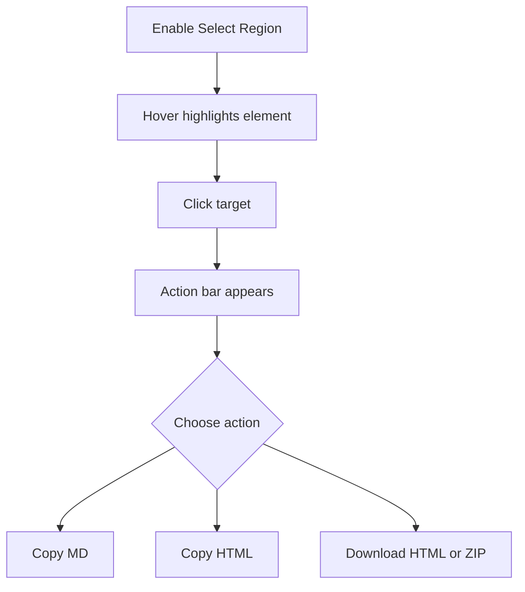

<!-- markdownlint-disable MD013 MD033 MD045 -->

# Region Selection

> Lets a user pick a page element and export only that scoped region as Markdown, HTML, or ZIP.

  
  
  

Related: [README](../../../README.md) · [Markdown & HTML Extraction](../markdown-html-extraction/feature.md) · [HTML Clone ZIP Netlify](../html-clone-zip-netlify/feature.md) · [Visual Edit](../visual-edit/feature.md) · [Component Inspector](../component-inspector/feature.md)

---

## 🔍 1. Overview

|                      |                                                                                                                                          |
| -------------------- | ---------------------------------------------------------------------------------------------------------------------------------------- |
| **Scope**            | Popup toggle, context-menu region copy, hover highlight, expand/shrink selection, and scoped Markdown/HTML/ZIP export.                   |
| **Default state**    | 🟢 `regionSelect: true` in `src/shared/feature-flags.js`.                                                                                |
| **Selection source** | 🟢 Clicked element from selection mode or `lastRightClickedElement` from the `contextmenu` event.                                        |
| **Main limits**      | 🟡 Browser live smoke is manual-pending; static checks committed pass 10/10. Cross-frame selection depends on the injected target frame. |

> [!NOTE]
> Region selection is mutually exclusive with Visual Edit and Inspect. Enabling one disables the others in both popup coordination and content-script mode handlers.

---

## 🔄 2. How-To Flows

### Select a region from the popup

1. Click **Select Region** in the popup toolbar.
2. The content script enables capture listeners and closes the popup after activation.
3. Hover a page element; `.web2md-region-highlighted` applies a dashed outline.
4. Click the element to stop selection and show `#web2md-region-actions-bar`.
5. Choose **Copy MD**, **Copy HTML**, **HTML**, or **ZIP**.

### Adjust selected scope

1. After selecting an element, click **Expand** to move to its parent element.
2. Click **Shrink** to return through `selectionHistory`.
3. Export only when the label shows the intended element description.

### Use the context-menu path

1. First load the content bundle in that tab, for example by using **Extract Page** or **Select Region** once.
2. Right-click a page element.
3. Choose a Web2MD context-menu copy action.
4. The handler uses `lastRightClickedElement`; if none exists, the page shows `No element selected to copy`.

> [!WARNING]
> On first use in a fresh tab, the context-menu click can inject Web2MD only after the originating browser `contextmenu` event has already occurred. That event cannot be recovered, so no element is available until the content listener has been loaded and the user right-clicks again.

---

## 🧪 3. QA Test Scenarios

### ✅ Happy paths

| #   | Scenario                              | Expected                                                                                                                    |
| --- | ------------------------------------- | --------------------------------------------------------------------------------------------------------------------------- |
| H1  | Enable selection and click an element | 🟢 Action bar appears near the element and page click is prevented.                                                         |
| H2  | Copy MD for a selected form region    | 🟢 Markdown includes parent/preceding headings plus preprocessed region content.                                            |
| H3  | Copy HTML for a selected region       | 🟢 Clipboard receives serialized self-contained node HTML.                                                                  |
| H4  | Download region ZIP                   | 🟢 ZIP download contains `index.html`, optional `styles.css`, optional `scripts.js`, assets, and optional `mock_apis.json`. |

### 🔒 Permissions/world security

| Scenario                   | Expected                                                                                    |
| -------------------------- | ------------------------------------------------------------------------------------------- |
| Run on Chrome system page  | 🟢 Popup blocks with `Cannot inspect Chrome system pages.`                                  |
| Action bar clicked         | 🟢 Region selection ignores clicks inside `#web2md-region-actions-bar` and `#web2md-toast`. |
| Extension overlays present | 🟢 Clone serialization excludes Web2MD overlay/highlight nodes.                             |

### ⚠️ Input/output validation

| Input/output        | Invalid condition                                  | Expected                                                                                                   |
| ------------------- | -------------------------------------------------- | ---------------------------------------------------------------------------------------------------------- |
| Context menu region | Content listener was not loaded before right-click | 🟡 First action cannot recover that element; load a Web2MD content feature, right-click again, then retry. |
| ZIP export          | `JSZip` missing                                    | 🟡 Toast shows `JSZip not loaded`.                                                                         |
| Hidden descendants  | `display:none` or `visibility:hidden`              | 🟢 Marked `data-web2md-ignore` during export and restored afterward.                                       |

### 🚫 Feature interaction/business rules

| Scenario                        | Expected                                                                                                  |
| ------------------------------- | --------------------------------------------------------------------------------------------------------- |
| Enable while Visual Edit active | 🟢 Visual Edit is disabled before selection starts.                                                       |
| Enable while Inspect active     | 🟢 Inspect is disabled through `WEB2MD_TOGGLE_INSPECT`.                                                   |
| Region HTML/ZIP export          | 🟢 `serializePageToSelfContainedHtml` receives `targetElement`, so output is scoped to the selected node. |

### 🧾 Sensitive data/storage

| Data            | Handling                                                                         |
| --------------- | -------------------------------------------------------------------------------- |
| Region Markdown | 🟢 Uses same password masking and form preprocessing as page Markdown.           |
| Region HTML/ZIP | 🟡 Serializes live form values in selected scope, including non-password inputs. |
| Storage         | 🟢 No region selection state is persisted; active selection is in page memory.   |
| Browser smoke   | 🟡 Manual-pending; committed static checks pass 10/10.                           |

---

## 📚 4. Reference

### Code paths

| Path                                       | Role                                                                            |
| ------------------------------------------ | ------------------------------------------------------------------------------- |
| `src/content/region-select/mode.js`        | Selection active state, context-menu target tracking, hover/click/key handlers. |
| `src/content/region-select/actions-bar.js` | Floating action bar, expand/shrink, region Markdown/HTML/ZIP actions.           |
| `src/popup/mode-toggles.js`                | Popup toggle wiring and mutual exclusion with Inspect/Visual Edit.              |
| `src/background/context-menus.js`          | Context-menu entry point for right-click region copy.                           |
| `src/content/html-clone/serializer.js`     | Scoped HTML serialization through `targetElement`.                              |

### Actions and DOM IDs

| Name                         | Type           | Purpose                                           |
| ---------------------------- | -------------- | ------------------------------------------------- |
| `toggleRegionSelection`      | runtime action | Enables/disables region picking.                  |
| `getRegionSelectionState`    | runtime action | Reads active state for popup sync.                |
| `contextMenuCopyRegion`      | runtime action | Copies right-clicked element in requested format. |
| `#web2md-region-actions-bar` | DOM overlay    | Export toolbar.                                   |
| `.web2md-region-highlighted` | CSS class      | Dashed selection outline.                         |

---

## 💡 5. Explanation

### Selection is element-scoped, not text-range scoped

Region export starts from an element reference rather than a text `Range`. That lets HTML and ZIP exports preserve descendants, styles, assets, shadow DOM serialization, and form state for the chosen region.

### Expand/shrink is intentionally one-dimensional

> [!IMPORTANT]
> **Invariant:** Region actions must use the current selected element, not the original clicked element after scope changes.

`currentSelectedElement` plus `selectionHistory` keeps scope changes predictable without implementing arbitrary DOM tree navigation.

---

## 📑 Changelog

| Date       | Entry                                                                                         |
| ---------- | --------------------------------------------------------------------------------------------- |
| 2026-07-30 | Documented as-built v0.2.0; browser smoke manual-pending; committed static checks pass 10/10. |
