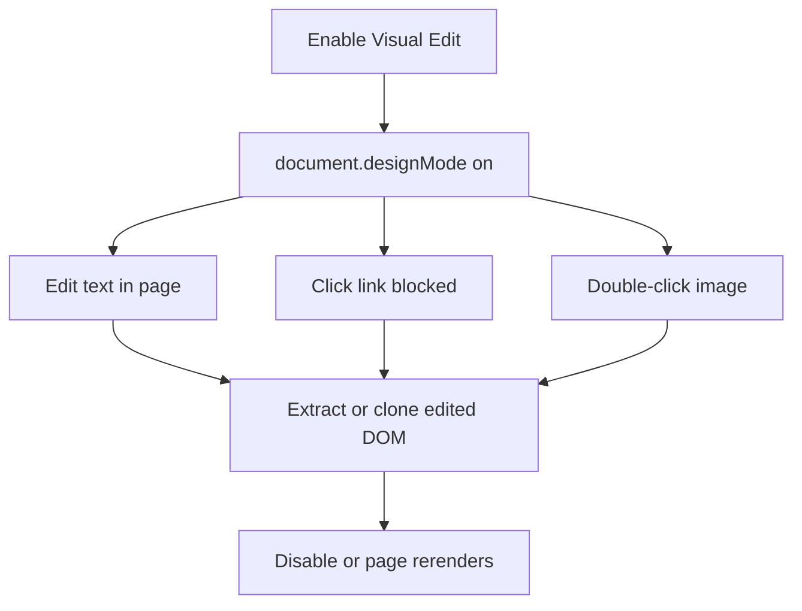

<!-- markdownlint-disable MD013 MD033 MD045 -->

# Visual Edit

> Temporarily edits the live page DOM so users can adjust text, links, and images before extracting or cloning.

  
  

Related: [README](../../../README.md) · [Markdown & HTML Extraction](../markdown-html-extraction/feature.md) · [Region Selection](../region-selection/feature.md) · [Component Inspector](../component-inspector/feature.md)

---
> [!IMPORTANT]
> **Deprecation Notice (v0.3.0):** This feature has been removed from `web2md-extension`. Editing text is directly supported in markdown after extraction, eliminating unnecessary DOM mutation on live sites.

## 🔍 1. Overview

|                   |                                                                                                                          |
| ----------------- | ------------------------------------------------------------------------------------------------------------------------ |
| **Scope**         | Toggle `document.designMode`, edit page text, block link navigation during edit, and update image `src` on double-click. |
| **Default state** | 🔴 `visualEdit: false` in `src/shared/feature-flags.js`.                                                                 |
| **Persistence**   | 🟡 DOM-only and nonpersistent; changes can be lost on reload or SPA rerender.                                            |
| **Main limits**   | 🟡 Browser live smoke is manual-pending; static checks committed pass 10/10. No remote save exists.                      |

> [!IMPORTANT]
> Visual Edit changes the current DOM only. It does not patch app state, source files, backend data, or remote pages.

---

## 🔄 2. How-To Flows

### Edit visible page text

1. Enable **Visual Edit** in the popup toolbar.
2. Content script sets `document.designMode = "on"` and injects `#web2md-visual-edit-styles`.
3. Hovered elements receive `.web2md-hover-active`.
4. Edit page text directly, then run extraction or clone while the edited DOM is still present.

### Edit link/image behavior

1. While Visual Edit is active, click a link.
2. Navigation is prevented and toast shows `Link click blocked in Edit Mode`.
3. Double-click an image and enter a new URL in the prompt.
4. The image element `src` is updated in the live DOM.

### Disable edit mode

1. Toggle **Visual Edit** off.
2. Content script sets `document.designMode = "off"`.
3. Web2MD styles and hover classes are removed.

---

## 🧪 3. QA Test Scenarios

### ✅ Happy paths

| #   | Scenario                      | Expected                                                                         |
| --- | ----------------------------- | -------------------------------------------------------------------------------- |
| H1  | Enable and type in page text  | 🟢 Text changes appear in the page DOM.                                          |
| H2  | Extract after editing text    | 🟢 Markdown reflects current DOM text if the page has not rerendered.            |
| H3  | Clone after editing image URL | 🟢 HTML clone serializes the updated `src`.                                      |
| H4  | Disable mode                  | 🟢 `document.designMode` returns to `off`; visual edit style element is removed. |

### 🔒 Permissions/world security

| Scenario                  | Expected                                                      |
| ------------------------- | ------------------------------------------------------------- |
| Run on Chrome system page | 🟢 Popup blocks with `Cannot edit Chrome system pages.`       |
| Click link while active   | 🟢 Navigation is blocked to prevent accidental page change.   |
| Feature flag off          | 🟢 Visual Edit UI is hidden by `[data-feature="visualEdit"]`. |

### ⚠️ Input/output validation

| Input/output | Invalid condition                       | Expected                          |
| ------------ | --------------------------------------- | --------------------------------- |
| Image prompt | Empty string or cancel                  | 🟢 Image `src` remains unchanged. |
| Hover target | Body, document element, or Web2MD toast | 🟢 No hover class added.          |
| SPA state    | App rerenders edited component          | 🟡 App may overwrite DOM edits.   |

### 🚫 Feature interaction/business rules

| Scenario                             | Expected                                                                   |
| ------------------------------------ | -------------------------------------------------------------------------- |
| Enable while Region Selection active | 🟢 Region mode is disabled first.                                          |
| Enable while Inspect active          | 🟢 Popup sends `toggleInspect` false before enabling edit.                 |
| Extract/clone after edit             | 🟢 Output uses the currently mutated DOM; no separate edit history exists. |

### 🧾 Sensitive data/storage

| Data                | Handling                                                                                                         |
| ------------------- | ---------------------------------------------------------------------------------------------------------------- |
| Edited DOM          | 🟢 Not stored by Visual Edit.                                                                                    |
| Remote page/backend | 🟢 No remote save API is called.                                                                                 |
| Settings            | 🟢 Feature enabled state is controlled by feature flags in `chrome.storage.sync`; edit content is not persisted. |
| Browser smoke       | 🟡 Manual-pending; committed static checks pass 10/10.                                                           |

---

## 📚 4. Reference

### Code paths

| Path                                     | Role                                                                               |
| ---------------------------------------- | ---------------------------------------------------------------------------------- |
| `src/content/visual-edit/visual-edit.js` | `document.designMode`, hover class, link blocking, image prompt, runtime handlers. |
| `src/popup/mode-toggles.js`              | Popup Visual Edit toggle and mutual exclusion.                                     |
| `src/shared/feature-flags.js`            | `visualEdit: false` default.                                                       |
| `src/content/html-clone/serializer.js`   | Excludes `#web2md-visual-edit-styles` and hover classes during clone.              |

### Runtime names/messages

| Name                         | Type           | Purpose                            |
| ---------------------------- | -------------- | ---------------------------------- |
| `toggleVisualEdit`           | runtime action | Enables/disables edit mode.        |
| `getVisualEditState`         | runtime action | Reads active state for popup sync. |
| `#web2md-visual-edit-styles` | DOM style ID   | Hover outline style.               |
| `.web2md-hover-active`       | CSS class      | Active hover indicator.            |

---

## 💡 5. Explanation

### DOM-only editing is deliberate

The feature is a pre-extraction staging tool, not a CMS. Avoiding persistence keeps the extension from inventing app-specific save semantics or sending user edits to unknown backends.

### SPA rerender behavior is a hard limit

> [!IMPORTANT]
> **Invariant:** Visual Edit output is only reliable while the edited DOM remains present.

React/Vue/Angular rerenders may restore component output from app state. Users should extract or clone immediately after making edits they want captured.

---

## 📑 Changelog

| Date       | Entry                                                                                         |
| ---------- | --------------------------------------------------------------------------------------------- |
| 2026-07-30 | Documented as-built v0.2.0; browser smoke manual-pending; committed static checks pass 10/10. |
| 2026-10-23 | Deprecated and removed in v0.3.0; eliminated `visual-edit.js` and header toolbar toggle. |
